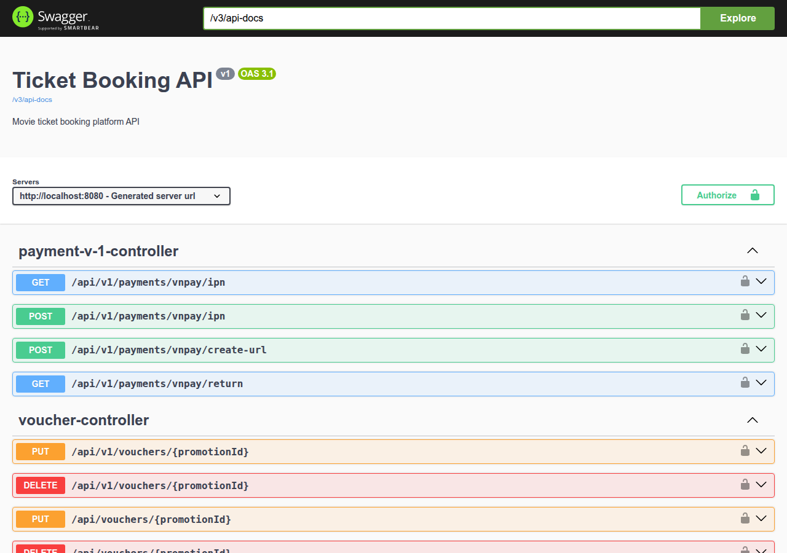
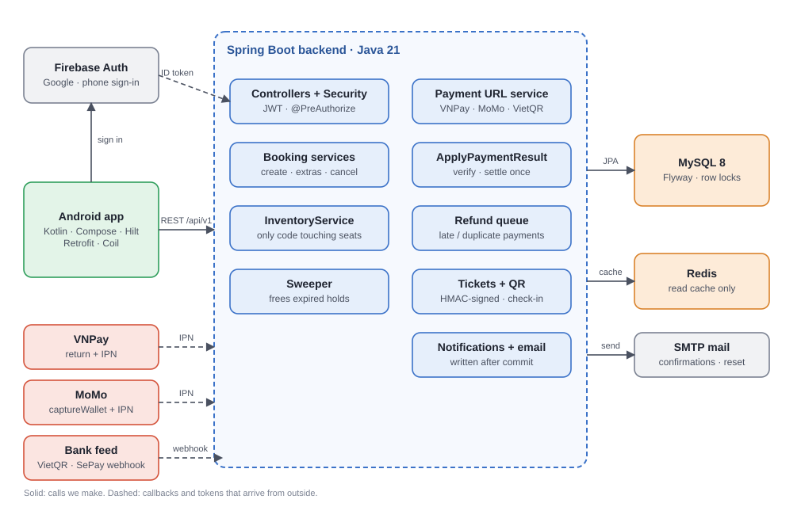
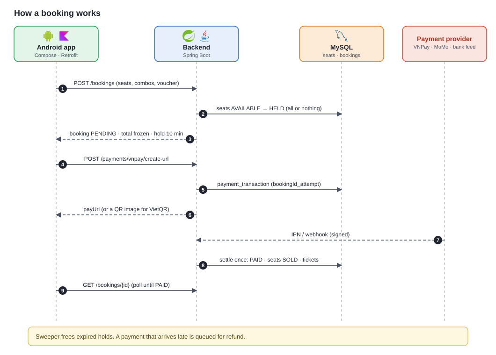

<h1 align="center">CETA Cinema – Backend</h1>

<p align="center">
  The REST API behind a cinema ticket-booking app.<br>
  Seat inventory with a hold, three payment methods, QR tickets and refunds.
</p>

<p align="center">
  
  
  
  
  <a href="https://github.com/Chunporo/ceta-movie-ticket-backend/actions/workflows/ci.yml"></a>
</p>

> [!NOTE]
> A personal learning project, not a commercial product. Payments run against local simulators; no real merchant account is connected. The Android client is in [`ceta-android`](https://github.com/Chunporo/ceta-android).

## Technology stack and features

- **Spring Boot 3.5 on Java 21**: Web, Security, Data JPA, WebSocket, Validation, Mail.
- **MySQL 8 with Flyway**: every schema change is a new migration, and `ddl-auto` stays `validate`.
- **Redis** as a read cache only. Never used for locks or as a source of truth.
- **JWT and Firebase sign-in**: email and password, Google and phone sign-in, lockout after 5 wrong passwords, password reset and account deletion.
- **Seat inventory with hold**: seats are held for 10 minutes while the customer pays; a sweeper frees expired holds; seat changes are pushed over STOMP.
- **Bookings with a frozen price**: `tickets + combos − voucher − points = total`, checked at creation and again at payment.
- **Three payment methods**: VNPay, MoMo and VietQR bank transfer, settled by one idempotent use case. A late payment goes to a refund queue.
- **Movie catalogue**: movies carry cast with photos, a wide backdrop image, and scores from TMDB, IMDb, Rotten Tomatoes and Metacritic (kept apart from the customers' own rating).
- **After payment**: HMAC-signed QR tickets, staff check-in, customer and showtime cancellation, notifications, loyalty points, reviews and reminders.
- **Swagger UI** from [springdoc](https://springdoc.org/) in the `dev` profile.
- **Tests**: JUnit 5 and H2, [ArchUnit](https://www.archunit.org/) boundary rules, and MySQL tests for row locking.

### Interactive API documentation

<p align="center">
  
</p>

Run with the `dev` profile and open <http://localhost:8080/swagger-ui/index.html>.

### Architecture

<p align="center">
  
</p>

Technology logos are from [devicon](https://devicon.dev/) (MIT). The diagram also exists as an editable [draw.io file](docs/images/architecture.drawio): open it at [app.diagrams.net](https://app.diagrams.net/).

## How a booking works

<p align="center">
  
</p>

Editable source: [`docs/images/booking-flow.drawio`](docs/images/booking-flow.drawio).

Rules that keep it correct:

- Only `InventoryService` may touch the `showtime_seat` table. An ArchUnit test enforces it.
- Locks are always taken in the same order: booking row first, then showtime or seats. Payment callbacks, the sweeper and cancellations all follow it.
- Every payment callback goes through `ApplyPaymentResultUseCase`. It checks the signature, the merchant and the exact amount, and `payment_transaction.processed_at` makes replays harmless.
- Schema changes are new Flyway migrations. `V1__baseline.sql` is never edited.

## Run it locally

Requirements: JDK 21, Docker (for MySQL and Redis), and Python 3 if you want the payment simulators.

```bash
git clone https://github.com/Chunporo/ceta-movie-ticket-backend.git
cd ceta-movie-ticket-backend
git checkout dev

# MySQL and Redis
docker run -d --name ceta-mysql -p 3306:3306 -e MYSQL_ROOT_PASSWORD=root -e MYSQL_DATABASE=ceta mysql:8
docker run -d --name ceta-redis -p 6379:6379 redis:7

# Backend (the dev profile adds Swagger and SMTP settings)
sh ./mvnw spring-boot:run -Dspring-boot.run.profiles=local,dev
```

The API answers on <http://localhost:8080>. Put secrets and local settings in `src/main/resources/application-local.properties`, which is git-ignored. On first start a seeder creates cinemas, rooms, showtimes, combos, offers and a local admin account (`admin@gmail.com` / `admin@123`; change it for anything that isn't your own machine).

Point the Android emulator at it: the app's `dev` flavor uses `http://10.0.2.2:8080/api/v1/`.

### Database configuration

MySQL is required for the real app, and Flyway creates the schema on start. The unit tests use an in-memory H2 database, so they need no setup. The row-locking tests need real MySQL (see [Tests](#tests)).

### Loading real movies

`scripts/import_tmdb.py` fills the catalogue from [TMDB](https://www.themoviedb.org/) and creates showtimes. It needs `TMDB_API_KEY` (and `OMDB_API_KEY` for the IMDb, Rotten Tomatoes and Metacritic scores) plus an admin login:

```bash
TMDB_API_KEY=... ADMIN_EMAIL=... ADMIN_PASSWORD=... python3 scripts/import_tmdb.py --base http://localhost:8080
python3 scripts/import_tmdb.py --refresh-ratings   # later: refresh the scores
python3 scripts/import_tmdb.py --showtimes-only --showtimes-for-existing   # no TMDB key: only create showtimes
```

## Deploying

`docs/DEPLOY.md` describes free ways to host it: one VM with `docker compose` (MySQL, backend and Caddy for HTTPS), a Hugging Face Space plus a hosted MySQL, or this very machine behind Tailscale Funnel (`deploy/local/run-public.sh`). The image is built from the `Dockerfile` and runs the `prod` profile, which reads every secret from environment variables, turns Swagger off, and creates **no** default admin: the first admin exists only when `ADMIN_PASSWORD` is set. The dev admin above is never created there.

## Continuous integration

[`ci.yml`](.github/workflows/ci.yml) runs `scripts/verify.sh` against a MySQL 8 service and the `it-mysql` suite on every push and pull request. The protected branch requires both checks.

## Payments without merchant accounts

Each method is off until its properties are set, and `GET /api/v1/payments/methods` tells the app which ones are on. Local simulators stand in for the gateways:

| Method | Turn on with | Simulator |
|---|---|---|
| VNPay | `vnpay.tmn-code`, `hash-secret`, `url`, `return-url` | `scripts/vnpay_sim.py` (port 8099), signed return and IPN |
| MoMo | `momo.partner-code`, `access-key`, `secret-key`, `redirect-url`, `ipn-url` | `scripts/momo_sim.py` (port 8098) |
| VietQR | `vietqr.bank-id`, `account-no`, `webhook-key` | `scripts/vietqr_sim.py <note> <amount>` |

VietQR shows a QR image from `img.vietqr.io` with the amount and a transfer note (`CETA<bookingId>A<attempt>`). A bank-feed aggregator then calls the backend when the money arrives. Both VietQR's documented callback and a SePay-style webhook are served; run the simulator with `--style sepay` for the second.

> [!WARNING]
> The VNPay, MoMo and VietQR payloads follow public docs as I read them and are checked only against these simulators, not against real accounts or sandboxes.

## Tests

```bash
sh ./mvnw -q test                              # unit tests on H2, no MySQL needed
bash ./scripts/verify.sh                       # forbidden-pattern checks, protected files, full test run
IT_MYSQL_URL=jdbc:mysql://localhost:3306/ceta \
  sh ./mvnw -q -Pit-mysql test                 # row-locking and concurrency tests on real MySQL
```

`verify.sh` needs `bash`, not `sh`. The MySQL profile runs only tests tagged `it-mysql`, including a rehearsal of the payment incidents: a lost IPN, an IPN after the hold lapsed, an app killed mid-payment, and two users racing for one seat. Tests never call real VNPay.

## Looking for something in particular?

| What | Where |
|---|---|
| Seat claim, hold and release | `service/inventory/InventoryServiceImpl.java` |
| Booking creation and price freezing | `service/BookingCreationServiceImpl.java`, `PricingService.java` |
| Snacks, vouchers and points | `service/BookingExtrasCalculator.java`, `LoyaltyServiceImpl.java` |
| Payment settlement (all providers) | `service/payment/ApplyPaymentResultUseCaseImpl.java` |
| VNPay, MoMo and VietQR specifics | `service/payment/` (`momo/`, `vietqr/`), `controller/PaymentMomoController.java`, `PaymentV1Controller.java` |
| Hold expiry sweeper | `service/BookingSweeper.java`, `BookingExpiryServiceImpl.java` |
| Refunds | `service/RefundServiceImpl.java`, `controller/AdminRefundController.java` |
| Tickets, QR and check-in | `service/ticket/`, `controller/TicketV1Controller.java`, `AdminTicketController.java` |
| Security rules | `config/SecurityConfig.java` |
| Live seat updates | `config/WebSocketConfig.java`, `StompJwtInterceptor.java` |
| Database schema | `src/main/resources/db/migration/` |
| Local payment simulators | `scripts/` |

Paths are under `src/main/java/com/movie/ticket_booking/`.

## Contributing and docs

This repo follows a strict working contract, so read these before changing code:

- [`AGENTS.md`](AGENTS.md): the rules (invariants, forbidden patterns, protected files, one task per commit).
- [`CLAUDE.md`](CLAUDE.md): detailed architecture notes, endpoint by endpoint.
- [`docs/BASELINE.md`](docs/BASELINE.md): the business source of truth.
- [`docs/CETA_Android_Spec.md`](docs/CETA_Android_Spec.md): the API contract the app uses.

Run `bash ./scripts/verify.sh` before committing. Every controller endpoint needs `@PreAuthorize` and a row in `AuthorizationMatrixTest`.

## License

No license has been chosen yet, so all rights are reserved by default.
