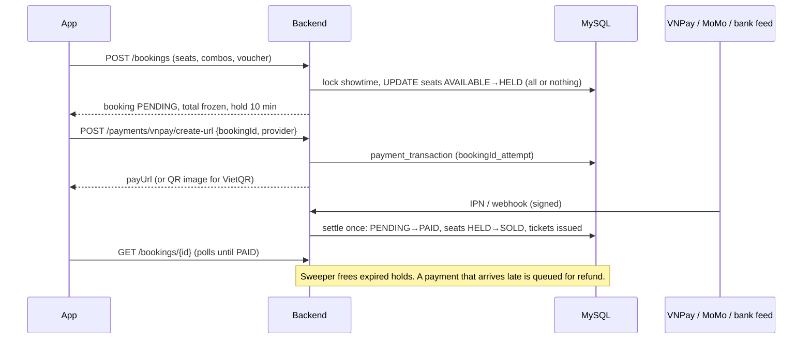

<h1 align="center">CETA Cinema – Backend</h1>

<p align="center">
  The REST API behind a cinema ticket-booking app.<br>
  Seat inventory with a hold, three payment methods, QR tickets and refunds.
</p>

<p align="center">
  
  
  
</p>

> [!NOTE]
> A personal learning project, not a commercial product. Payments are exercised against local simulators; no real merchant account is connected. The Android client is in [`ceta-android`](https://github.com/Chunporo/ceta-android).

## Features

- **Catalog:** cinemas, rooms, movies, showtimes (2D, 3D, IMAX; subtitled or dubbed), snack combos, offers and vouchers.
- **Seat inventory with hold:** seats are held for 10 minutes while the customer pays, and a sweeper frees expired holds. Seat changes are pushed over STOMP/WebSocket.
- **Bookings:** the price is frozen when the booking is created. The money invariant is `tickets + combos − voucher − points = total`.
- **Payments:** VNPay, MoMo and VietQR bank transfer, all settled by one idempotent use case. A late payment goes to a refund queue.
- **After payment:** tickets with signed QR codes, staff check-in, customer cancellation, showtime cancellation, notifications, loyalty points, reviews and reminders.
- **Accounts:** email and password, Firebase sign-in (Google, phone), lockout after 5 wrong passwords, password reset, account deletion.

## Tech stack

- Java 21, [Spring Boot](https://spring.io/projects/spring-boot) 3.5 (Web, Security, Data JPA, WebSocket, Validation).
- MySQL 8 with [Flyway](https://flywaydb.org/) migrations; `ddl-auto` stays `validate`.
- Redis, used only as a read cache. Never for locks or as a source of truth.
- JWT for the API (Spring Security resource server). Firebase sign-in tokens are verified with Spring's JWT support.
- SMTP mail for confirmations and password reset.
- [springdoc](https://springdoc.org/) for Swagger UI in the `dev` profile.
- Tests: JUnit 5 and H2 for the unit suite, [ArchUnit](https://www.archunit.org/) for architecture rules, and MySQL-only tests for row locking.

## Architecture

<p align="center">
  
</p>

The diagram is also available as an editable [draw.io file](docs/images/architecture.drawio): open it at [app.diagrams.net](https://app.diagrams.net/) or in the VS Code draw.io extension.

## How a booking works



Key rules that keep this correct:

- Only `InventoryService` may touch the `showtime_seat` table. An ArchUnit test enforces it.
- Locks are always taken in the same order: booking row first, then showtime or seats. Payment callbacks, the sweeper and cancellations follow it.
- Every payment callback goes through `ApplyPaymentResultUseCase`. It checks the signature, the merchant and the exact amount, and `payment_transaction.processed_at` makes replays harmless.
- Schema changes are new Flyway migrations. `V1__baseline.sql` is never edited.

## Run it

```bash
# MySQL and Redis
docker run -d --name ceta-mysql -p 3306:3306 -e MYSQL_ROOT_PASSWORD=root -e MYSQL_DATABASE=ceta mysql:8
docker run -d --name ceta-redis -p 6379:6379 redis:7

# Backend (the dev profile adds Swagger and SMTP settings)
sh ./mvnw spring-boot:run -Dspring-boot.run.profiles=local,dev
```

Put secrets and local settings in `src/main/resources/application-local.properties` (git-ignored). On first start a seeder creates cinemas, rooms, combos, offers and an admin account for local use.

## Payments without merchant accounts

Each method is off until its properties are set, and `GET /api/v1/payments/methods` tells the app which ones are on. Local simulators stand in for the gateways:

| Method | Turn on with | Simulator |
|---|---|---|
| VNPay | `vnpay.tmn-code`, `hash-secret`, `url`, `return-url` | `scripts/vnpay_sim.py` (port 8099), signed return and IPN |
| MoMo | `momo.partner-code`, `access-key`, `secret-key`, `redirect-url`, `ipn-url` | `scripts/momo_sim.py` (port 8098) |
| VietQR | `vietqr.bank-id`, `account-no`, `webhook-key` | `scripts/vietqr_sim.py <note> <amount>` |

VietQR shows a QR image from `img.vietqr.io` with the amount and a transfer note (`CETA<bookingId>A<attempt>`). A bank-feed aggregator then calls the backend when the money arrives. Both VietQR's documented callback and a SePay-style webhook are served; run the simulator with `--style sepay` for the second.

> [!WARNING]
> The VNPay, MoMo and VietQR payloads follow public docs as I read them and are checked only against these simulators, not against real accounts or sandboxes.

## Tests

```bash
sh ./mvnw -q test                              # unit tests on H2, no MySQL needed
bash ./scripts/verify.sh                       # forbidden-pattern checks, protected files, full test run
IT_MYSQL_URL=jdbc:mysql://localhost:3306/ceta \
  sh ./mvnw -q -Pit-mysql test                 # row-locking and concurrency tests on real MySQL
```

`verify.sh` needs `bash`, not `sh`. The MySQL profile runs only tests tagged `it-mysql`, including a rehearsal of the payment incidents: a lost IPN, an IPN after the hold lapsed, an app killed mid-payment, and two users racing for one seat.

## Project layout

```
src/main/java/com/movie/ticket_booking/
  controller/   REST endpoints (each one has @PreAuthorize)
  service/      booking, payment, inventory, refunds, tickets, loyalty, notifications
  config/       security, seeder, WebSocket
  entity/ repository/ dto/ exception/
src/main/resources/db/   Flyway migrations
scripts/                 simulators and verify.sh
```

## Docs

- [`AGENTS.md`](AGENTS.md): the rules for working in this repo.
- [`CLAUDE.md`](CLAUDE.md): detailed architecture notes, endpoint by endpoint.
- [`docs/BASELINE.md`](docs/BASELINE.md): the business source of truth.
- [`docs/CETA_Android_Spec.md`](docs/CETA_Android_Spec.md): the API contract the app uses.
